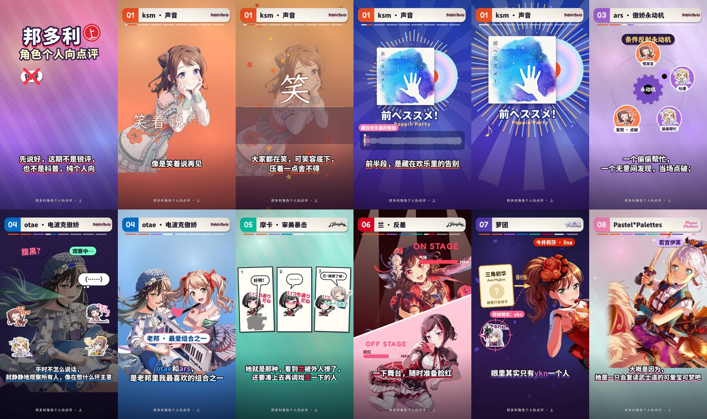

# 邦多利角色个人向点评 · 上

这是一期竖屏（9:16）点评视频，全长 5′12″，用曼波音色配音，内容是对 BanG Dream! 老乐队几位角色的个人向点评。
它做成了实时渲染的网页，不是视频文件：画面在 1080×1920 的 canvas 上逐帧绘制，
字幕和动画都对齐到配音里每个字的时间点。



**打开 `index.html`，点「播放」就能看。** 直接双击用 `file://` 打开可以，放到任何静态服务器上也可以。
所有路径都是相对路径，播放时不需要联网。
点击画面暂停，空格键播放/暂停，←/→ 快退/快进 5 秒。

```
bandori-review-vol1/
├─ index.html        播放页
├─ app.js            画面引擎 + 10 个段落，由 src/ 拼接而成（classic script，可在 file:// 下运行）
├─ preview.jpg
├─ assets/
│  ├─ audio.mp3      配音 + 背景音乐（自动闪避）+ 程序合成音效，混成一条音轨
│  ├─ timeline.js    每句话、每个字的时间点，以及音乐切换计划
│  ├─ viz.js         音乐频谱数据，用于唱片周围的可视化
│  ├─ fonts.js       按实际用字子集化的 WOFF2 字体（base64）
│  ├─ img/           角色卡面抠图、游戏内贴图、歌曲封面、乐队 logo（webp）
│  └─ LICENSES.md
├─ src/              可读源码：engine / widgets / timeline / 各段分镜 / 音效提示点 / main
└─ tools/            文案、配音、对齐、时间轴、混音、字体、打包、渲染脚本
```

## 段落

| 时间 | 段落 | 画面 |
| --- | --- | --- |
| 0:00 | 开场 | 「锐评」「科普」被划掉，换成「纯个人向」；5 支乐队 25 人的 Q 版贴图里，只有本期要聊的 11 人亮起 |
| 0:12 | 01 ksm · 声音 | 手写体「笑着说再见」；「秋天」「毕业那几天」两张拍立得；水面倒影「笑 / 舍不得」；《前へススメ!》唱片从封套滑出，周围是实时频谱；歌曲波形上标出「藏在欢乐里的告别 → 坚定·向前」；最后留 11 秒只放歌 |
| 1:05 | 02 ksm · 距离 | 朋友轨道图：外圈越来越多的朋友，内圈 4 个核心位已满；「你」想挤进内圈被弹回；单向箭头和「单向度」；放大镜里的「尴尬 × ∞」 |
| 1:43 | 03 ars · 傲娇永动机 | 《傲娇学标准教科书》；五个节点的条件反射循环：怪发言 → 吐槽 → 偷偷帮忙 → 发现点破 → 脸红否认，越转越快；「才、才不是！」/ 内心得意度 MAX |
| 2:12 | 04 otae · 电波克傲娇 | 剪影 → 上色（印象值 8 → 100）；「腹黑？」雷达扫描；划掉腹黑换成天然电波；语言系统解码失败；属性克制「效果拔群！」 |
| 2:48 | 05 摩卡 · 审美暴击 | 审美清单逐项打勾，「命中率 100%」；摩卡 ≈ otae；三格漫画「兰被撩了 → 脸红 → 摩卡凑上去」 |
| 3:20 | 06 兰 · 反差 | ON STAGE / OFF STAGE 斜切分屏，气场 MAX、脸红 MAX，「……没什么。」 |
| 3:31 | 07 萝团 | 好感刻度尺、团内气压表；ykn / sayo「个人口味 · 不太合」；lisa = 强化版初华，视线锁定 ykn，三项对比条 |
| 4:05 | 08 Pastel*Palettes | 「认识进度」加载条；名字认不全、乐队名拼错三次；maya「ジブン……っす！」/ 户外节目；伊芙复读「ブシドー！」+ 图鉴卡；千圣的名片翻面变成「朋友」 |
| 5:05 | 结尾 | 9 张角色小卡，各配一句总结，「下期见！」 |

## 配音、字幕和读音

- **配音**：开源 TTS 模型 [VoxCPM2](https://huggingface.co/openbmb/VoxCPM2)（Apache-2.0）加上
  [曼波讲故事音色 LoRA](https://huggingface.co/rav009/VoxCPM2-lora-manbo)，全部在 CPU 上逐句合成。
- **字幕与读音分开**：文案里写 `[字幕|读音]`，字幕显示前半，配音读后半。缩写读日语罗马音，
  比如 ksm 读 Kasumi、ars 读 Arisa；中文译名就读中文。
- **核对**：每句配音都用 Whisper 识别回来，按拼音与原文比对，读错的句子重新合成。
  字幕直接来自文案，不来自语音识别，所以字幕和配音一定一致。
- **对齐**：每个字在配音里的时间点，由 Whisper 的词级时间戳对齐得到。画面里的动作都卡在具体的字上，
  比如说到「克制」时屏幕震动。

## 音乐

| 段落 | 曲目 | 处理 |
| --- | --- | --- |
| 开场 → ksm 前半 | STAR BEAT!〜ホシノコドウ〜 (Lo-Fi Remix) | 背景，-19 dB，说话时再压 7 dB |
| ksm · 声音 | 前へススメ！— Poppin'Party | 从开头清唱起；说到「坚定起来」时接到结尾段，让「だから どんなに夢が遠くたって…前へ進め」落在 11 秒的纯音乐空档里 |
| ksm · 距离 | キズナミュージック♪ (Lo-Fi Remix) | 背景 |
| ars | す、好きなんかじゃない！（钢琴版，ars 的角色曲） | 背景 |
| otae / 摩卡 / 兰 | TWiNKLE CiRCLE (Lo-Fi Remix) | 背景 |
| 萝团 → 结尾 | もういちど ルミナス (Lo-Fi Remix) | 背景 |

音效（pop、盖章、唱片刮擦、电波、刀鸣等 24 种）由 `tools/sfx.py` 程序合成，没有用任何采样。

## 重新生成

需要：Python 3（numpy、soundfile、librosa、voxcpm、faster-whisper、pypinyin、fonttools、brotli）、
Node 22 + Playwright、ffmpeg。下面的 `<work>` 是任意工作目录，`<music>` 放上表的 48 kHz wav：
`lofi_p1`、`lofi_p2`、`lofi_p5`、`lofi_p10`、`maesusume`、`ars_piano`。

```sh
python tools/make_voice.py tools/script.txt <work> <VoxCPM2 dir> <LoRA step dir>   # 逐句合成（已合成的会跳过）
python tools/align.py <work>                                  # Whisper 核对 + 每字时间点
python tools/build_timeline.py <work> <work>/align.json       # → assets/timeline.js
python tools/build_fonts.py <ttf dir>                         # → assets/fonts.js
python tools/bundle.py                                        # src/ → app.js
python tools/build_audio.py <work> <music>                    # → assets/viz.js
node tools/render.mjs cues <work>/sfx.json                    # 从页面导出音效提示点
python tools/build_audio.py <work> <music> <work>/sfx.json    # → assets/audio.mp3
bash tools/render_video.sh <outdir>                           # 可选：1080p MP4，分 3 段 + 完整版
```

## 核实过的事实

- **缩写读音**：ksm、ars、ykn 按「取罗马音辅音」的规律读作 Kasumi / Arisa / Yukina，
  这是推断，没有找到权威的对照来源；otae 读 Otae（おたえ）。
  中文名用的是 Bestdori 上的官方中文名（户山香澄、市谷有咲、花园多惠、青叶摩卡、美竹兰……）。
- **峰月律**：《BanG Dream! YUME∞MITA》里「夢限大MewType」的节奏吉他手，不是老邦角色，
  所以只做成摩卡段里的一张便利贴旁白，没有配图。
- **《前へススメ!》的结构**：用 Whisper 转写了歌词时间戳，开头约 0:00–0:19 是轻声的开场，
  4:21 起是「だから…前へ進め」的收尾段，据此安排了切点。

素材版权归各权利方所有，本项目仅作个人非商业的二次创作练习，详见 [`assets/LICENSES.md`](assets/LICENSES.md)。
